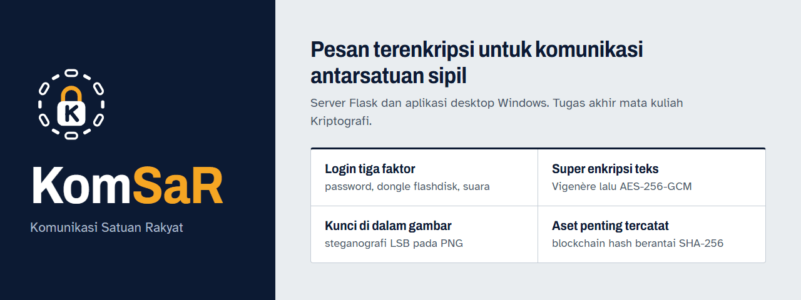
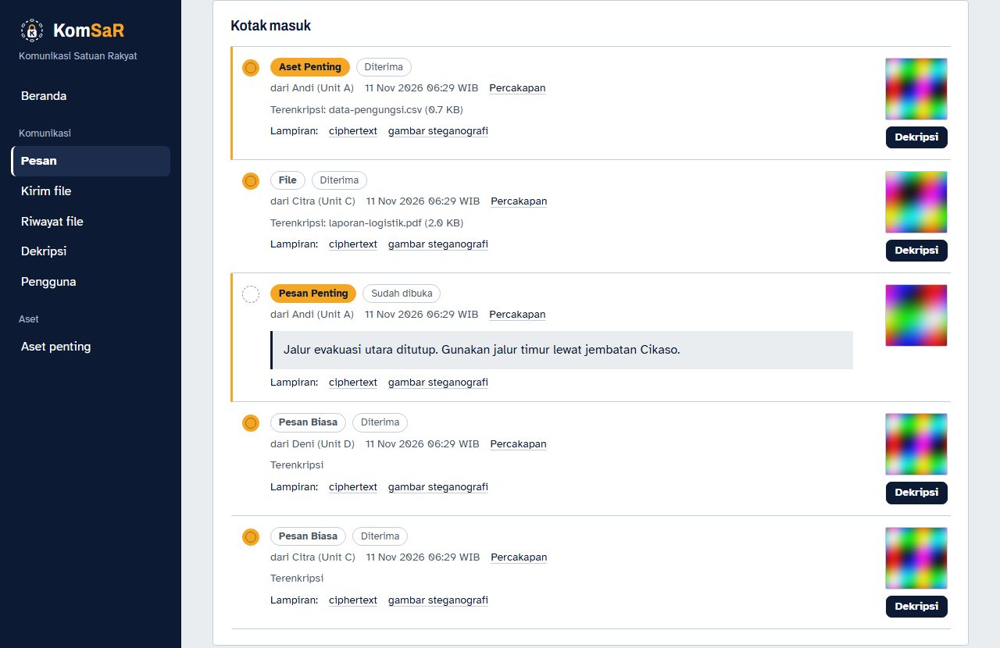
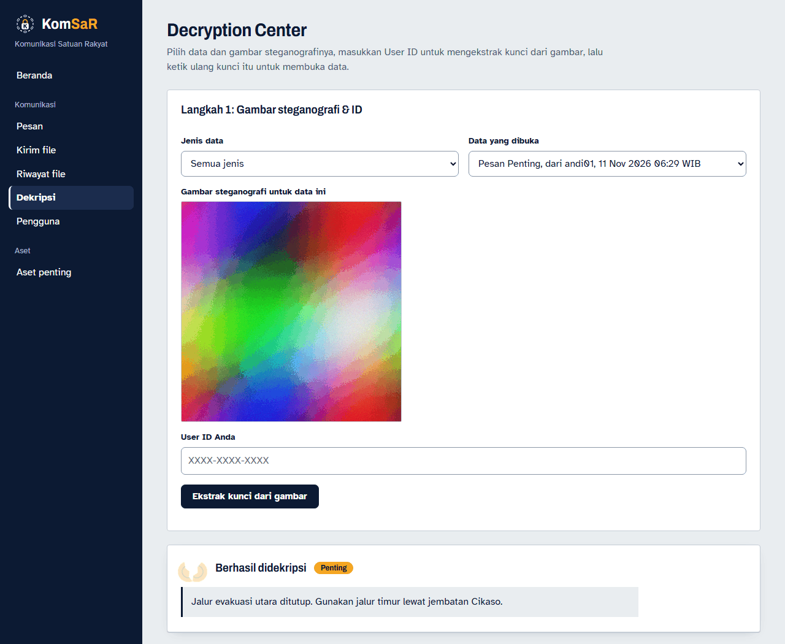
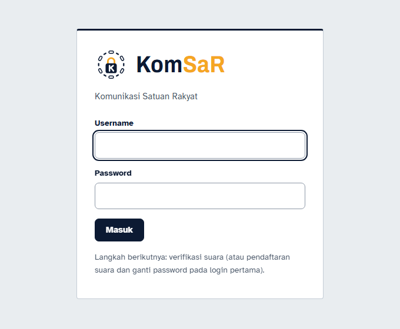
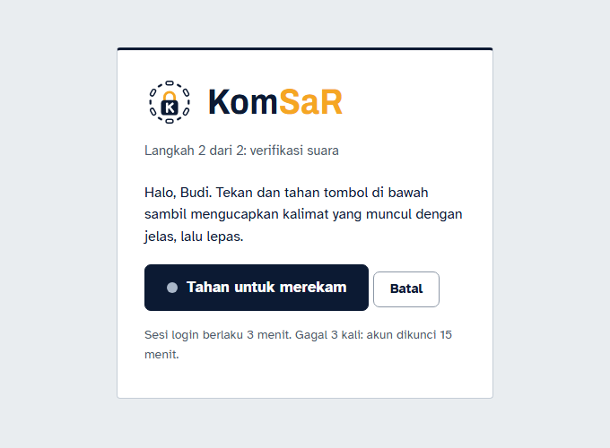
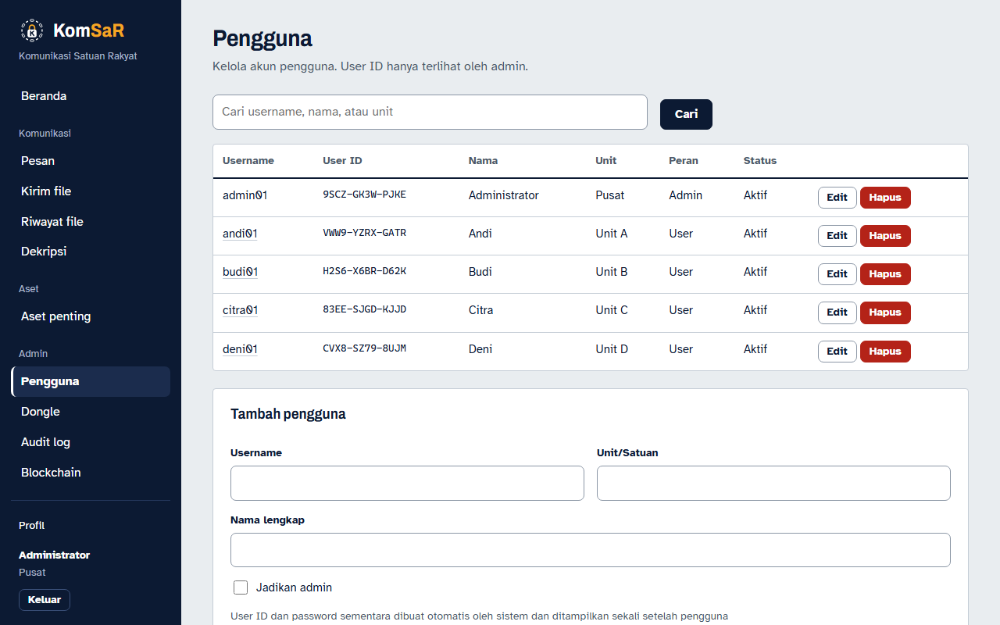
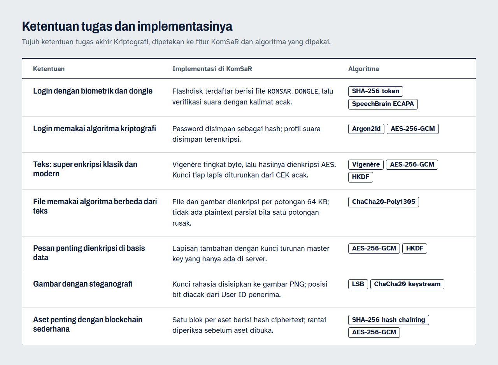

<p align="center">
  <a href="https://github.com/Fronz31/Kripto_TugasAkhir_KomSaR/releases/latest"></a>
  
  
  
  
</p>

**KomSaR (Komunikasi Satuan Rakyat)** adalah aplikasi pesan terenkripsi untuk satuan-satuan sipil yang
perlu bertukar pesan, file, dan dokumen penting tanpa bisa dibaca pihak lain, termasuk oleh siapa pun yang
hanya memegang isi database. Proyek ini adalah tugas akhir mata kuliah Kriptografi: sebuah prototipe
pembelajaran, **bukan sistem siap produksi** (lihat [Keterbatasan](#keterbatasan-keamanan)).

Sistemnya terdiri dari server Flask (di InstaCloud, data di PostgreSQL Neon) dan aplikasi desktop Windows
`KomSaR.exe` yang membaca dongle flashdisk, merekam suara, dan menampilkan halaman server.

## Tampilan

| Kotak masuk: pesan biasa, pesan penting, file, dan aset | Pesan penting setelah berhasil didekripsi |
|---|---|
|  |  |

| Login | Verifikasi suara (tahan untuk merekam) | Admin: daftar pengguna |
|---|---|---|
|  |  |  |

Data di tangkapan layar adalah data demo dari server lokal (SQLite sementara, kunci acak).

## Ketentuan tugas dan implementasinya



| Ketentuan | Implementasi di KomSaR | Algoritma |
|---|---|---|
| Login dengan biometrik dan dongle | Flashdisk terdaftar berisi `KOMSAR.DONGLE`, lalu verifikasi suara dengan kalimat acak | SHA-256 (token dongle), SpeechBrain ECAPA (cosine similarity) |
| Login memakai algoritma kriptografi | Password disimpan sebagai hash; profil suara disimpan terenkripsi | Argon2id, AES-256-GCM |
| Teks: super enkripsi klasik + modern | Vigenère tingkat byte, lalu AES; kunci tiap lapis diturunkan dari CEK acak | Vigenère, AES-256-GCM, HKDF |
| File memakai algoritma berbeda dari teks | File dan gambar dienkripsi per potongan 64 KB | ChaCha20-Poly1305 |
| Pesan penting dienkripsi di basis data | Lapisan tambahan dengan kunci turunan master key yang hanya ada di server | AES-256-GCM, HKDF |
| Gambar dengan steganografi | Kunci rahasia disisipkan ke PNG; posisi bit diacak dari User ID penerima | LSB, keystream ChaCha20 |
| Aset penting dengan blockchain sederhana | Satu blok per aset berisi hash ciphertext; rantai diperiksa sebelum aset dibuka | SHA-256 hash chaining |

Lokasi kode tiap algoritma ada di [`komsar/docs/teknis.md`](komsar/docs/teknis.md#algoritma-yang-dipakai).

## Cara pakai

1. Unduh **`KomSaR.exe`** dari [rilis terbaru](https://github.com/Fronz31/Kripto_TugasAkhir_KomSaR/releases/latest).
   Satu file, tanpa instalasi; alamat server sudah tertanam di dalamnya. Untuk server lain, taruh `config.json`
   di samping exe (lihat [`komsar/desktop/README.md`](komsar/desktop/README.md)). Bila muncul Windows
   SmartScreen, pilih **More info → Run anyway** (exe belum ditandatangani).
2. Colokkan dongle flashdisk yang sudah didaftarkan admin, lalu buka `KomSaR.exe`.
3. **Login pertama:** masuk dengan password sementara dari admin, ganti password (minimal 8 karakter),
   lalu rekam tiga kalimat acak untuk mendaftarkan suara. Harus selesai dalam 24 jam sejak akun dibuat.
4. **Login berikutnya:** username dan password, lalu tahan tombol rekam sambil mengucapkan kalimat yang muncul.
5. Kirim pesan dari menu **Pesan**, file dari **Kirim file**, dan buka kiriman dari **Dekripsi** dengan
   User ID Anda (diberikan admin) dan kunci rahasia yang muncul dari gambar.

Alur lengkap untuk pengguna dan admin: [`komsar/docs/alur-fitur.md`](komsar/docs/alur-fitur.md).


## Arsitektur


Kode server berlapis: route (HTTP) → service (logika) → modul murni `crypto/`, `stego/`, `blockchain/`.
Struktur folder lengkap ada di [`komsar/docs/teknis.md`](komsar/docs/teknis.md#struktur-proyek).

## Alur kriptografi


Penerima butuh dua hal untuk membuka kiriman: **User ID** miliknya dan **kunci rahasia** yang tersembunyi di
gambar. Semua lapis memakai mode AEAD, jadi ciphertext yang diubah ditolak, bukan menghasilkan teks rusak.
Aset penting juga diperiksa ke blockchain (hash ciphertext, rantai, metadata) sebelum didekripsi.

## Untuk pengembang

Prasyarat: Python 3.12 dan [`uv`](https://docs.astral.sh/uv/). Mode development berjalan di browser biasa
tanpa dongle dan suara, dengan akun contoh (password `komsar123`):

```powershell
cd komsar
uv venv --python 3.12 .venv
uv pip install --python .venv -r requirements.txt
$env:KOMSAR_REQUIRE_DONGLE="0"; $env:KOMSAR_COOKIE_SECURE="0"; $env:VOICE_BACKEND="fake"
$env:FLASK_DEBUG="1"; $env:KOMSAR_SEED_DEMO="1"
.venv\Scripts\python run.py        # buka http://127.0.0.1:5000
```

Kelima variabel itu **hanya** untuk development; jangan dipakai di server. Pengujian:

```powershell
.venv\Scripts\python -m pytest -q                                   # server
uv venv --python 3.12 desktop/.venv
uv pip install --python desktop/.venv -r desktop/requirements.txt pytest
desktop/.venv/Scripts/python -m pytest -q desktop/tests             # aplikasi desktop
```

Konfigurasi, endpoint, dan detail dongle/suara: [`komsar/README.md`](komsar/README.md).

## Deploy

Server di-deploy ke InstaCloud dari `Dockerfile` di root repo, dengan database PostgreSQL Neon. Admin pertama
dibuat dengan `flask --app wsgi komsar bootstrap-admin`. Langkah lengkap, secret, dan mode uji coba ada di
[`komsar/docs/deploy.md`](komsar/docs/deploy.md).

> Simpan `KOMSAR_DB_MASTER_KEY` baik-baik. Bila kunci ini hilang atau diganti, pesan penting dan profil
> suara yang sudah tersimpan tidak bisa dibuka lagi.

## Dokumentasi

| Dokumen | Isi |
|---|---|
| [`komsar/docs/alur-fitur.md`](komsar/docs/alur-fitur.md) | alur fitur untuk pengguna dan admin |
| [`komsar/docs/teknis.md`](komsar/docs/teknis.md) | algoritma, alur detail, struktur kode, blockchain, pengujian |
| [`komsar/README.md`](komsar/README.md) | menjalankan lokal, konfigurasi, login, halaman, dongle, suara |
| [`komsar/desktop/README.md`](komsar/desktop/README.md) | instalasi, build, dan kontrak aplikasi desktop |
| [`komsar/docs/deploy.md`](komsar/docs/deploy.md) | deploy InstaCloud + Neon, secret, admin pertama |
| [`komsar/docs/uji-manual.md`](komsar/docs/uji-manual.md) | checklist uji manual dengan perangkat nyata |
| [`komsar/docs/keamanan.md`](komsar/docs/keamanan.md) | keterbatasan keamanan |
| [`komsar/docs/PLAN.md`](komsar/docs/PLAN.md) | rencana dan status implementasi |

Visual README dibuat dari HTML di [`docs/readme/src/`](docs/readme/src/) dan diekspor dengan
`uv run --with pillow python docs/readme/src/export.py`.

## Keterbatasan keamanan

Ringkasnya (rincian di [`komsar/docs/keamanan.md`](komsar/docs/keamanan.md)):

- Rekaman suara bisa diputar ulang, dan akurasinya bergantung pada ambang yang harus dikalibrasi.
- Dongle bisa dipalsukan oleh pihak yang menyalin file dongle dan mengetahui serial volumenya.
- User ID acak tetapi bukan kata sandi: admin mengetahuinya dan database menyimpannya apa adanya.
- Blockchain bersifat *tamper-evident*, bukan *tamper-proof*; penulisan ulang seluruh rantai tidak terdeteksi
  oleh rantai itu sendiri, tetapi ciphertext yang diubah tetap ditolak AEAD.
- Siapa pun yang menguasai server memegang master key; nama file asli dan metadata tidak dienkripsi.
- Server wajib berjalan dengan satu worker gunicorn karena sebagian state ada di memori proses.

## Status

Semua fitur sudah diimplementasikan dan diuji otomatis: kriptografi, steganografi, blockchain, penyimpanan
database, login tiga faktor, aplikasi desktop, dan deploy. Yang masih berjalan adalah uji di perangkat nyata:
akurasi dan kalibrasi suara, Neon dan InstaCloud produksi, serta aplikasi desktop dengan mikrofon dan flashdisk
di laptop tim ([checklist](komsar/docs/uji-manual.md)).

## Tim

Tugas akhir mata kuliah Kriptografi.

| Nama | NIM |
|---|---|
| Bintang Ramadhan | 123240073 |
| Fahmi Firdaus | 123240055 |
| Farabian Nabil Alauzi | 123240058 |

Kontributor repositori: [Fronz31](https://github.com/Fronz31), [TangRmdhn](https://github.com/TangRmdhn).
